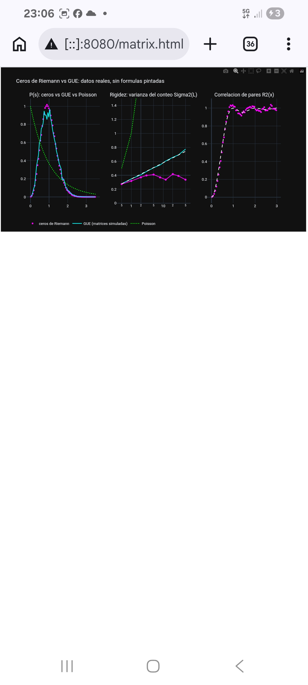

<div align="center">

# El pulso fractal del infinito

### Una lectura geométrica y espectral de la Hipótesis de Riemann

**PFI-01** · Programa de investigación computacional · **v0.5**

*Benjamín Cabeza Durán*

</div>

---

## Qué es

Un **pipeline computacional abierto** que mide la estructura estadística de los ceros no triviales de ζ(s) y la compara con predicciones teóricas cerradas (GUE, Poisson, Selberg, Berry). No es una demostración: es un instrumento que dice qué se puede afirmar con los datos y qué no.

> *"Nada de esto demuestra ni refuta la Hipótesis de Riemann."*

---

## Novedades de la v0.5: del «qué» al «cómo» (ensayos E10–E18)

Los ceros ya están medidos; aquí se pregunta de dónde sale esa estructura. Cada ensayo lleva dato, teoría exacta y un control. Detalle en `docs/ENSAYOS.md`, `ensayo3_enteros_y_ceros/README.md` y `analisis_avanzado/README.md`.

| Ensayo | Resultado | Tipo |
|---|---|---|
| SYK N=22 frente a los ceros | Misma clase GUE en ⟨r⟩, P(s), Δ₃ y R₂ (RMS 0.020; control N=16 GOE: 0.089). Comparten clase estadística, **no origen** | Positivo |
| `xp` en una caja (Berry–Keating) | Da un peine rígido (⟨r⟩ = 1), no GUE. Parte del artefacto de rejilla está documentado | Negativo |
| Jacobi inverso con 80 ceros | Indistinguible de GUE (rms 3.02 frente a 3.70 ± 0.38). No identifica un operador | Negativo |
| Positividad de Weil | La matriz construida solo con primos coincide con la de los ceros a 1e-10; autovalor mínimo > 0 | Positivo (comprobación, no prueba) |
| ψ(x) desde los ceros | Error RMS de reconstrucción: 0.743 con 10 ceros, 0.022 con 10⁵; control con γ al azar ≈ 2.5 | Positivo |
| Enteros → ceros (`ensayo3_enteros_y_ceros/`) | Con M = N_RS = ⌊√(t/2π)⌋ enteros se fijan el 96.8 % de los ceros a t = 10⁴ | Positivo |
| GUE + primos insertados | Falla: ⟨r⟩ baja a 0.580 y el «silencio» de la suma sobre ceros es 2.68 frente a 0.01 en los ceros reales | Negativo |
| Riemann–Siegel con C₀ | Reproduce las posiciones de los ceros a ≲ 1.5×10⁻⁴ espaciados y el silencio (0.010–0.014, igual que los reales). Propiedad conocida, aquí cuantificada | Positivo |
| E18: x^(−1/2)(ψ(x) − x) hasta 10⁷ | Ver abajo | Positivo |

### E18. La oscilación de los primos con 100 ceros

`psi_escalada.py` (solo numpy; matplotlib únicamente para dibujar). D(x) = (ψ(x) − x)/√x, con ψ exacta por criba hasta 10⁷.

| | valor |
|---|---|
| rango de D | [−0.770, 0.673] |
| RMS(D − fórmula explícita con 100 ceros) | 0.078 |
| RMS(D − control con 100 γ al azar) | 0.325 |
| RMS(D) | 0.243 |
| máx. \|D\| con x ≥ 101 | 0.757 |

La cota condicional a RH, ln x (ln x − ln ln x)/(8π) para x ≥ 101 (Schoenfeld y Grenié–Molteni; leída en arXiv:2312.05628, no rederivada), vale 8.55 en x = 10⁷; el máximo medido es el 94.7 % de la cota, en x ≈ 101, y queda muy por debajo después. Cumplir una cota **condicional** a RH no prueba RH; hasta 10⁷ no podía ser de otro modo.

Una nota de método: una primera ejecución dio un cociente 1.971 contra ln²x/8π. Era un artefacto: esa cota solo vale desde x ≈ 73.2 y la rejilla empezaba en x = 20.

**Corrección de afirmaciones anteriores:** el ruido de K(τ) en SYK es ±0.3–0.5 (antes escribí ±0.05–0.1); una estimación mía de |S| ≈ 0.7 para Riemann–Siegel con M = N_RS resultó ser 1.40 al medirla.

---

## Contexto externo (25 nov 2026)

El 20 de noviembre de 2026 se anunció una prueba formalizada en Lean de la Hipótesis de Riemann (en realidad de la generalizada), atribuida a Levent Alpöge y descrita como hallada con ayuda de Claude. Según lo publicado, compila, usa tres axiomas estándar y la han aceptado varios verificadores; quedan pendientes una ejecución «paranoica» del kernel y el Comparator. Está en revisión por la comunidad. Este repositorio **no la da por cerrada ni por refutada**, y no la usa ni depende de ella: no he podido consultar la declaración original del autor, y los recuentos de ficheros y líneas que circulan no coinciden entre fuentes. Si se confirma, responde al «qué» y a RH, pero no hace innecesarias las preguntas de este programa (de dónde sale la estructura GUE de los ceros), que son de otro tipo.

---

## Resumen de la v0.4 (base, sin cambios)

| Resultado | Estado |
|---|---|
| Estadística local (P(s), ⟨r⟩, correlación de pares) sigue GUE con la corrección de altura finita esperada | Medido, reproducible |
| Σ²(L) satura a gran escala (saturación de Berry), no crece como GUE | Medido, reproducible |
| Conteo de ceros consistente con N(T) hasta t ≈ 1.13×10⁶, con detector validado por borrado | Medido (numérico, no riguroso) |
| Var S(T) crece como ln ln T y la curtosis tiende a 3, hasta el cero nº 10²² | Medido; reproduce a Selberg |
| "Atractor extraño" D₂ ≈ 1.2256 | **Retirado** (el control barajado da 1.2322) |
| "Red cósmica" / "materia oscura" | **Retirado** (metáfora visual sin contenido físico) |

---

## Datos

Tablas de ceros de A. Odlyzko (<https://www-users.cse.umn.edu/~odlyzko/zeta_tables>). Los datos no son del autor; se descargan, no se versionan:

```bash
cd analisis_avanzado
curl -L -o ceros_2M.txt.gz https://www-users.cse.umn.edu/~odlyzko/zeta_tables/zeros6.gz   # 2.001.052 ceros
curl -L -o zeros3.txt https://www-users.cse.umn.edu/~odlyzko/zeta_tables/zeros3            # 10^4 ceros desde el nº 10^12
curl -L -o zeros4.txt https://www-users.cse.umn.edu/~odlyzko/zeta_tables/zeros4            # ... desde 10^21
curl -L -o zeros5.txt https://www-users.cse.umn.edu/~odlyzko/zeta_tables/zeros5            # ... desde 10^22
```

`ceros_100k.txt` (primeros 100.000 ceros) está en el repo.

---

## Resultados

### 1. Estadística local (100.000 ceros)

Espaciados normalizados con la ley suave N(t) = θ(t)/π + 1.

| | ceros | GUE simulado | barajado | Poisson |
|---|---|---|---|---|
| ⟨r⟩ | 0.6109 | 0.6003 | 0.6519 | 0.386 |
| P(s<0.3) | 2.11 % | 2.58 % | 2.11 % | 26 % |
| corr(sₙ, sₙ₊₁) | −0.357 | −0.310 | −0.004 | 0.000 |

(GUE asintótico: ⟨r⟩ = 0.5996. GUE simulado: 40 matrices de 800×800, centro del espectro, *unfolding* con la ley del semicírculo.) Los ceros están algo más rígidos y más anticorrelacionados que GUE a esta altura: es la corrección de altura finita de Bogomolny–Keating.



*`analisis_avanzado/ver_matrix.py`: P(s), varianza del conteo Σ²(L) y correlación de pares R₂(x) frente a 1 − sinc². La curva teórica es la de Montgomery; los datos son los ceros reales.*

### 2. Gran escala: saturación de Berry

Σ²(L) sigue a GUE hasta L ≈ 5 y se aplana en torno a 0.35–0.45, mientras GUE sigue creciendo (0.74 en L = 50). Es la saturación semiclásica (Berry 1985), debida a las órbitas periódicas más cortas (potencias de primos). Fórmula GUE usada: Σ²(L) = (ln 2πL + γ + 1)/π².

### 3. Conteo tipo Turing (2.001.052 ceros, t hasta 1.13×10⁶)

d_n = (n − ½) − N_suave(tₙ) ≈ S(tₙ).

| | valor |
|---|---|
| media / desviación / máx. \|d\| | 0.000 / 0.332 / 1.33 |
| media de d por bloque de 10⁵ ceros | ≈ 0 en todos |
| control: borrar un cero a propósito | salto de −1.00 en la media local |

Un cero perdido (o un par fuera de la línea) se vería como un escalón de −1 (o −2 o más). No hay escalones. Es una comprobación **numérica**; la rigurosa (aritmética de bolas y cotas de S(T)) es la de Platt–Trudgian (arXiv:2004.09765), que cubre hasta t ≈ 3×10¹².

### 4. Convergencia con la altura (bloques de 10⁵ ceros)

| t medio | ⟨r⟩ | P(s<0.3) | corr |
|---|---|---|---|
| 4×10⁴ | 0.6109 | 2.11 % | −0.357 |
| 1.1×10⁶ | 0.6056 | 2.45 % | −0.347 |

⟨r⟩ se acerca despacio a GUE. Ajuste heurístico ⟨r⟩ = r∞ + a/ln²(t/2π) sobre 20 bloques: r∞ = 0.5998 (GUE: 0.5996). El rango de ln t es corto y el rms no distingue exponentes, así que es sugerente, no concluyente. La correlación sale con asíntota ≈ −0.336, que no coincide con mi GUE simulado (−0.31): sin resolver.

### 5. Estructura log-correlacionada (Selberg)

Var S(T) ≈ (1/2π²) ln ln T + cte; pendiente teórica 0.0507.

| origen | ln ln T | Var S | curtosis |
|---|---|---|---|
| t ≈ 10³ | 1.95 | 0.0728 | 2.57 |
| t ≈ 10⁶ | 2.60 | 0.1125 | 2.77 |
| ceros nº 10¹² | 3.27 | 0.1500 ± 0.0011 | 2.83 |
| ceros nº 10²¹ | 3.84 | 0.1809 ± 0.0017 | 2.90 |
| ceros nº 10²² | 3.89 | 0.1824 ± 0.0013 | 2.92 |

Pendiente efectiva: 0.0608 en t ≤ 10⁶ y ≈ 0.053 ± 0.003 entre 10¹² y 10²², compatible con 0.0507 (convergencia lenta desde arriba; interpretación sin comprobar contra términos de corrección). Cada ventana de Odlyzko es una sola realización de 10⁴ ceros; los errores (bootstrap de bloques) pueden estar subestimados. Esto reproduce el comportamiento que Selberg demostró; no es un resultado nuevo.

---

## Qué NO se sostiene (retirado en v0.4)

- **"Atractor extraño", D₂ ≈ 1.2256.** El número se reproduce, pero la pendiente local de C(r) cae de 1.76 a 0 sin zona de escalado, y barajar el orden de la sección de Poincaré da 1.2322. Además Γ(t) es analítica: su dimensión de caja a escala fina es 1, y cualquier valor intermedio es un cruce de resolución.
- **Inmersión de Takens 3D ("red cósmica", "materia oscura").** D₂ ≈ 3 a escalas pequeñas para los ceros, GUE y espaciados barajados: no los distingue. El vacío cerca del origen es la repulsión de niveles que ya mide P(s).
- **Prueba `pendiente % 1 != 0`** de `dimension_atractor.py`: vacía (cualquier flotante pasa).
- **`salida_pfi01_N1000/controles.csv`:** la fila "zeros_reales" (⟨r⟩ = 0.9935) es un bug; los ceros dan ≈ 0.61.
- **`ver_matrix.py` original** (matriz de correlación = `np.sinc(...)` fija, sin usar los datos) fue sustituido por la versión actual, que mide.

---

## Reproducibilidad

Los ensayos nuevos se ejecutan así (los scripts de ψ(x) están en `analisis_avanzado/`; los de enteros y ceros, con `run_all.sh`, en `ensayo3_enteros_y_ceros/`):

```bash
cd analisis_avanzado
python3 psi_escalada.py 1e7 ceros_100k.txt 100   # E18 -> psi_escalada.png
cd ../ensayo3_enteros_y_ceros && bash run_all.sh
```

Los de v0.4:

```bash
cd analisis_avanzado
python3 ver_matrix.py                                   # figura de 3 paneles -> matrix.html
python3 turing_alturas.py ceros_2M.txt.gz 100000        # conteo + estadística por bloques
python3 selberg.py ceros_2M.txt.gz                      # Var S vs ln ln T
python3 selberg_alturas.py zeros3.txt zeros4.txt zeros5.txt   # ventanas a 10^12, 10^21, 10^22
```

Requisitos: `numpy`, `plotly`, `mpmath`. En Termux: `pkg install python-numpy` y `pip install plotly mpmath`.

---

## Alcance y limitaciones

- Nada de esto demuestra ni refuta la Hipótesis de Riemann.
- Los ceros de las tablas están en la línea crítica por construcción: un cero fuera de ella no aparecería en ellas. Lo que sí detecta el conteo es una lista incompleta.
- Las ventanas a gran altura son una realización de 10⁴ ceros cada una.
- La lectura geométrica de Γ(t) es descriptiva; no hay criterio de "fractalidad" que un cero pueda violar. La estructura multifractal genuina (momentos de |ζ|, exponente k² de Keating–Snaith) está pendiente de medir.

---

## Referencias

Citadas de memoria salvo las que llevan enlace; conviene verificar los datos bibliográficos.

- Montgomery (1973), correlación de pares de los ceros.
- Selberg (1946), distribución de S(T).
- Berry (1985), *Semiclassical theory of spectral rigidity*, Proc. R. Soc. A 400, 229.
- Bogomolny & Keating (1996), Nonlinearity 9, 911.
- Bogomolny, Bohigas, Leboeuf & Monastra (2006), J. Phys. A 39, 10743.
- Atas, Bogomolny, Giraud & Roux (2013), PRL 110, 084101.
- Keating & Snaith (2000), Comm. Math. Phys. 214, 57; Fyodorov, Hiary & Keating (2012), PRL 108, 170601.
- Platt & Trudgian (2021), [The Riemann hypothesis is true up to 3·10¹²](https://arxiv.org/pdf/2004.09765).
- Odlyzko, [Tables of zeros of the Riemann zeta function](https://www-users.cse.umn.edu/~odlyzko/zeta_tables).

---

## Historial de versiones

**v0.4** — Estadística por altura hasta el cero nº 10²², conteo tipo Turing con control de borrado, Σ²(L) y saturación de Berry, test de Selberg. Se retiran el "atractor extraño" y la "red cósmica" tras controles negativos. Corrección propia: la fórmula teórica de Σ²(L) usaba la constante de GOE (−π²/8) en lugar de la de GUE; y el radio del semicírculo del *unfolding* de la primera simulación GUE era incorrecto.

**v0.3** — Estadística espectral con N = 5000; corrección de cuatro errores numéricos.

**v0.2 / v0.1** — Ver `docs/`.

---

## Transparencia

Parte del análisis (controles, scripts de la v0.4 y revisión crítica) se desarrolló con asistencia de Claude (Anthropic). Todo número de este documento puede regenerarse con el código incluido.

## Cómo citar

```bibtex
@misc{cabezaduran2026pfi01,
  author       = {Cabeza Durán, Benjamín},
  title        = {El pulso fractal del infinito (PFI-01)},
  year         = {2026},
  version      = {0.4},
  howpublished = {\url{https://github.com/mechmind-dwv/pulso_fractal_infinito}}
}
```

## Licencia

Ensayo y textos (`docs/`): CC BY-NC 4.0 · Código (`.py`): MIT · Datos generados (`salida_*/**.csv`): CC0. Las tablas de Odlyzko son de su autor.
